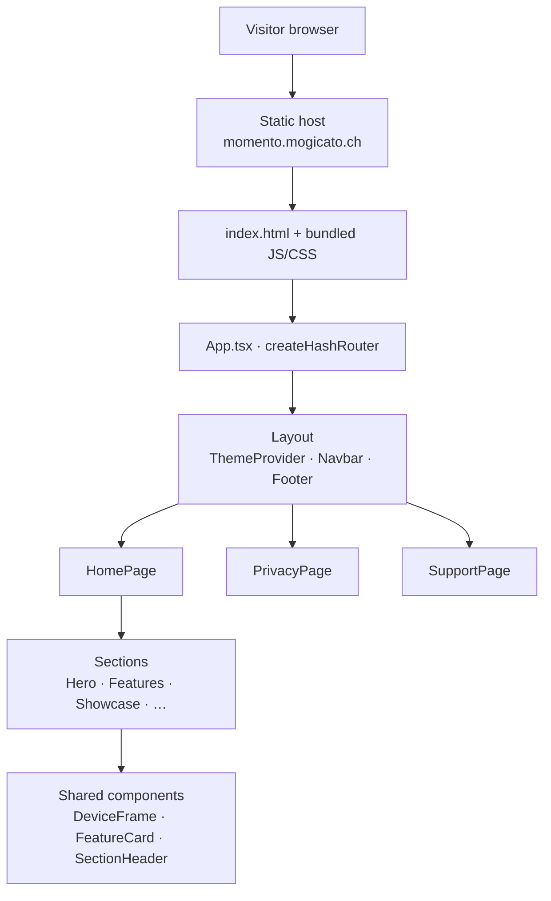

# Momento Website

The marketing, privacy and support site for **Momento** — a local-first iOS app for turning photos into personal moments, stories and Apple Photos albums.

[](https://github.com/Selimo100/momento_website/actions/workflows/ci.yml)


**Live site:** <https://momento.mogicato.ch>

---

## Overview

Momento is an iOS app that keeps photo memories on the device: no accounts, no backend, no
cloud sync. This repository contains the public website for the app — the product landing
page, the privacy policy and the support page that the App Store listing links to.

The site is a fully static single-page application. It is built with Vite, renders entirely
in the browser, ships no analytics or tracking, and makes no network requests beyond loading
its own assets and the Google Fonts stylesheet. That constraint is deliberate: a site for a
privacy-first app should not collect data about the people reading about it.

## Features

- **Product landing page** — hero, feature grid, use cases, screenshot showcase and a
  "how it works" walkthrough, composed from independent section components.
- **Privacy policy page** — the policy referenced from the App Store listing.
- **Support page** — FAQs and contact details for app users.
- **Light and dark theme** with system-preference detection, persisted per visitor.
- **Scroll-reveal animations** driven by a small `IntersectionObserver` hook, with Framer
  Motion handling page transitions.
- **Device frames** that present iPhone and iPad screenshots in realistic mockups.
- **Accessible by default** — skip-to-content link, semantic landmarks and focus-visible styles.

## Tech Stack

### Frontend

- [React 19](https://react.dev) with function components and hooks
- [TypeScript](https://www.typescriptlang.org) in strict bundler mode
- [React Router](https://reactrouter.com) (`createHashRouter`) for client-side routing
- [Framer Motion](https://www.framer.com/motion/) for page and section transitions
- [Tailwind CSS v4](https://tailwindcss.com) via the first-party Vite plugin
- [Lucide](https://lucide.dev) for icons

### Build & Tooling

- [Vite 8](https://vite.dev) as dev server and bundler
- [ESLint 10](https://eslint.org) with `typescript-eslint` and the React Hooks plugin
- [GitHub Actions](.github/workflows/ci.yml) for lint, type-check and build on every push and PR

There is no backend, no database and no runtime environment configuration — the build output
is a directory of static files.

## Architecture



`App.tsx` defines a hash router with a single `Layout` route. The layout owns the theme
context, the navigation bar and the footer; each page fills the outlet. `HomePage` is a
composition of section components, and sections reuse a small set of presentational
components. State is limited to theme selection and scroll position — there is no data layer.

See [`docs/architecture.md`](docs/architecture.md) for a fuller description of the
component layers, theming and animation approach.

## Project Structure

```text
.
├── .github/            # CI workflow, issue forms, PR template, Dependabot
├── docs/               # Architecture and deployment notes
├── public/             # Favicons and static icon sprite, copied verbatim
├── src/
│   ├── assets/         # Hero image and app screenshots (src/assets/screens)
│   ├── components/     # Reusable presentational components
│   ├── contexts/       # ThemeContext (light/dark/system)
│   ├── hooks/          # useScrollReveal, useScrolled
│   ├── pages/          # HomePage, PrivacyPage, SupportPage
│   ├── sections/       # Landing page sections, composed by HomePage
│   ├── index.css       # Tailwind entry point and design tokens
│   └── main.tsx        # Application entry point
├── index.html          # HTML shell with meta, Open Graph and font tags
├── eslint.config.js
├── vite.config.ts
└── package.json
```

## Getting Started

### Prerequisites

- [Node.js](https://nodejs.org) 20.19 or newer (Vite 8 requirement)
- npm 10 or newer (ships with Node)

### Installation

```bash
git clone https://github.com/Selimo100/momento_website.git
cd momento_website
npm ci
```

### Running Locally

```bash
npm run dev
```

Vite prints a local URL (`http://localhost:5173` by default) and reloads on save.

### Environment Variables

None. The site is fully static and reads no configuration at build or run time. If a future
change introduces one, add it to a `.env.example` file with a placeholder value and document
it here — never commit a populated `.env`.

### Building

```bash
npm run build     # type-checks with tsc -b, then bundles to dist/
npm run preview   # serves the production build locally
```

### Checks

```bash
npm run lint       # ESLint across the project
npm run typecheck  # TypeScript project references, no emit
```

The repository has no automated test suite today; see
[Remaining work](docs/architecture.md#testing) for the current thinking on that.

## Development

Day-to-day workflow, branch naming, commit conventions and the pull request process are
documented in [`CONTRIBUTING.md`](CONTRIBUTING.md).

In short: branch off `main`, keep `npm run lint` and `npm run build` green, use
[Conventional Commits](https://www.conventionalcommits.org), and open a pull request — CI
runs the same three checks on every push and PR.

## Deployment

`npm run build` produces a self-contained `dist/` directory that can be served by any static
host. The app uses a hash router, so no server-side rewrite rules are required for deep links
such as `/#/privacy`. Deployment details are in [`docs/deployment.md`](docs/deployment.md).

## Contributing

Contributions are welcome — please read [`CONTRIBUTING.md`](CONTRIBUTING.md) first.

## Security

Please report security issues privately. See [`SECURITY.md`](SECURITY.md).

## License

No license has been chosen for this repository yet, so default copyright applies: the source
is publicly readable, but not licensed for reuse. Momento branding, screenshots and copy are
not covered by any future code license.
