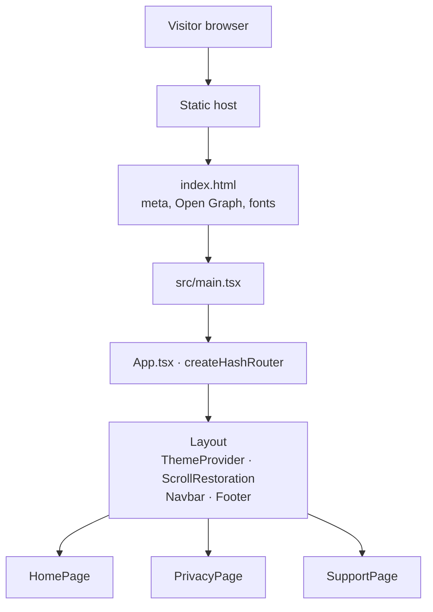
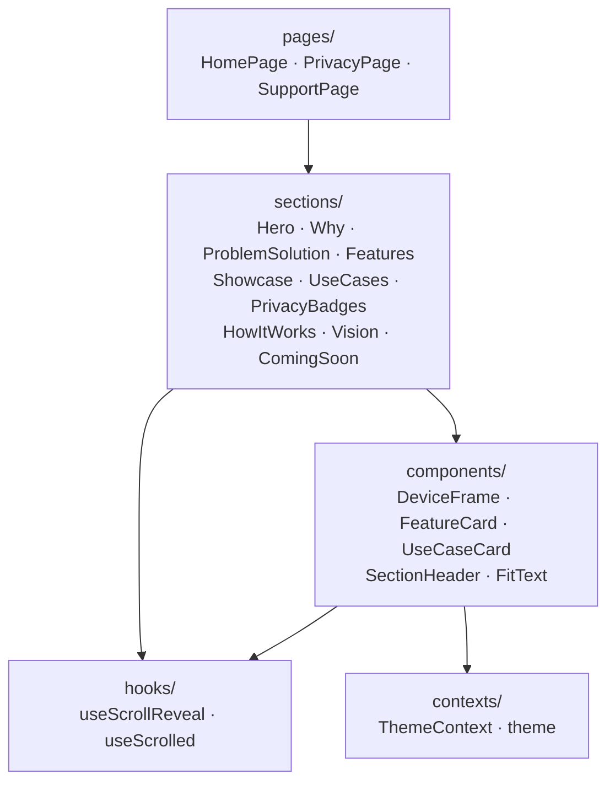

# Architecture

The Momento website is a client-rendered static single-page application. There is no server
component, no API and no persistent storage beyond a single `localStorage` key for the theme.
Everything below describes how the front end is organised.

## Runtime shape

`index.html` is the only HTML document served. It carries the document title, description,
Open Graph and Twitter Card metadata, favicon links and the Google Fonts stylesheet for
Manrope and DM Sans. `main.tsx` mounts `<App />` into `#root`.

## Routing

`App.tsx` builds a hash router (`createHashRouter`) with one layout route and three child
routes: `/`, `/privacy` and `/support`. A hash router is used deliberately — it makes the
build deployable to any static host without rewrite rules, which matters because
`/privacy` and `/support` are linked from the App Store listing and must never 404.

`Layout` owns everything that persists across routes:

- `ThemeProvider` — colour theme context
- `ScrollRestoration` — resets scroll position on navigation
- a skip-to-content link, `Navbar` and `Footer`
- `AnimatePresence` wrapping the `Outlet` so page changes can animate

## Component layers

Three layers, each with one responsibility:

- **`pages/`** — route targets. `HomePage` is purely a composition: it renders the ten
  landing sections in order inside `<main id="main-content">`. `PrivacyPage` and
  `SupportPage` hold long-form content.
- **`sections/`** — one file per landing page band. Each section owns its own copy, data
  arrays (for example the feature list in `Features.tsx`) and layout, and is self-contained
  enough to be reordered or removed by editing `HomePage` alone.
- **`components/`** — presentational building blocks reused across sections: `DeviceFrame`
  (iPhone/iPad mockup chrome around a screenshot), `FeatureCard`, `UseCaseCard`,
  `SectionHeader` and `FitText`.

There is no state management library and no data fetching. Content is authored directly in
the section components, which keeps the site a single build artefact with nothing to sync.

## Theming

The theme lives in two files: `contexts/theme.ts` holds the context object, its types and the
`useTheme` hook, while `contexts/ThemeContext.tsx` exports only the `ThemeProvider`
component. The split keeps Fast Refresh working — a module that exports both a component and
other values loses its refresh boundary.

`ThemeProvider` holds a `'light' | 'dark'` value. On first load it reads the
`momento-theme` key from `localStorage`, falling back to the
`prefers-color-scheme: dark` media query. Changes toggle a `dark` class on
`<html>`, set the body background colour to avoid a flash during theme switches, and write
the choice back to `localStorage`.

Tailwind v4 is configured for class-based dark mode through a `@custom-variant` in
`src/index.css`. The design system in that file is a two-tier token set: a fixed neutral
ramp plus a sage accent that never changes, and semantic tokens (`canvas`, `card`, `ink`,
`line`, …) that are redefined per theme and exposed to Tailwind through `@theme`. Components
should use the semantic tokens so they work in both themes automatically.

## Animation

Two mechanisms, used for different jobs:

- **`useScrollReveal(delay)`** — returns a ref; on mount it adds the `reveal` class (and an
  optional `reveal-delay-*` class), observes the element with `IntersectionObserver`, and
  adds `visible` once it enters the viewport, then unobserves. The transition itself is CSS
  in `src/index.css`. This covers the majority of on-scroll motion.
- **Framer Motion** — used for route transitions via `AnimatePresence` in the layout and for
  the few interactions that need spring physics rather than a CSS transition.

`useScrolled(threshold)` is a separate small hook that tracks whether the page has scrolled
past a threshold, used by the navbar to switch to its condensed style.

## Assets

`public/` holds files copied verbatim into the build: favicons in several formats, the
Apple touch icon and an SVG icon sprite. `src/assets/` holds files that go through Vite's
asset pipeline (hashed filenames, inlining of small files): the hero image, the app icon
used by the navbar and footer, and the compressed app screenshots in `src/assets/screens/`.

Screenshots are committed as JPEGs rather than the original PNG exports — the PNGs were an
order of magnitude larger for no visible quality gain on a page that displays them inside
device frames.

## Build

`npm run build` runs `tsc -b` across the two TypeScript project references
(`tsconfig.app.json` for `src/`, `tsconfig.node.json` for the Vite config) and then
`vite build`. TypeScript emits nothing — `noEmit` is set, so the compiler is purely a type
gate and Vite does the transpilation. Output is a static `dist/` directory.

## Testing

The site has no automated test suite. Its logic is limited to two small hooks and a theme
context, and the rest is presentational markup, so the value of unit tests here is low
relative to the maintenance cost.

The gap worth closing eventually is end-to-end coverage: a small Playwright suite asserting
that each route renders, that the theme toggle persists, and that the site has no console
errors would catch the failures that actually matter for a marketing site. Until then, CI
enforces linting, type-checking and a successful production build, and visual changes are
verified manually as described in [`CONTRIBUTING.md`](../CONTRIBUTING.md#checks).
